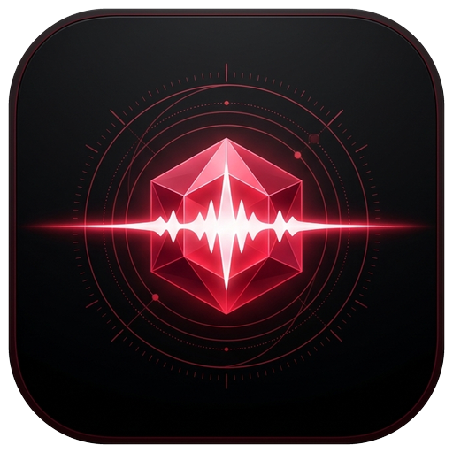
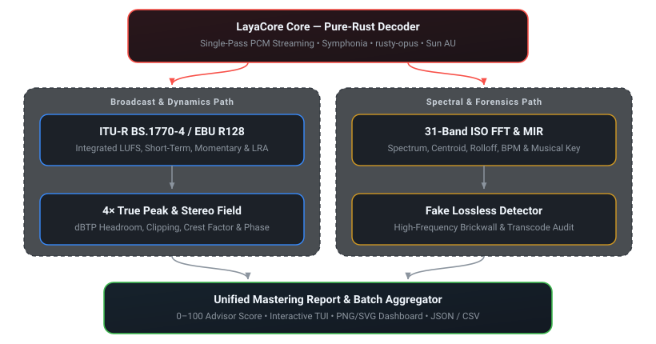

<p align="center">
  
</p>

<h1 align="center">LayaCore</h1>

<p align="center">
  <strong>Pure-Rust Audio Mastering, Dynamics, Spectral Telemetry &amp; Lossless Verification Suite for Windows</strong>
</p>

<p align="center">
  <a href="https://github.com/raveendra47/LayaCore/releases"></a>
  
  
  <a href="LICENSE"></a>
</p>

<p align="center">
  <em>Fast, offline, single-pass audio diagnostics and multi-core album auditing — built in 100% pure Rust with <strong>zero external C/FFI dependencies</strong> (no FFmpeg required).</em>
</p>

<p align="center">
  <a href="#-signal-pipeline">Signal Pipeline</a> •
  <a href="#-capabilities">Capabilities</a> •
  <a href="#-supported-formats">Formats</a> •
  <a href="#-installation">Installation</a> •
  <a href="#-usage">Usage &amp; CLI</a> •
  <a href="#-rust-library-api">Library API</a> •
  <a href="#-architecture">Architecture</a>
</p>

---

<table>
  <tr>
    <td width="33%" valign="top">
      <h4>⚡ Zero-FFI Rust DSP</h4>
      Native decoding and single-pass streaming analysis with zero C bindings, DLL headaches, or external binaries.
    </td>
    <td width="33%" valign="top">
      <h4>🎚️ Broadcast &amp; Mastering Grade</h4>
      ITU-R BS.1770-4 / EBU R128 loudness, 4× oversampled True Peak, stereo phase correlation, and automated readiness scoring.
    </td>
    <td width="33%" valign="top">
      <h4>🔍 Lossless Forensics</h4>
      Detects lossy MP3 transcodes upscaled into lossless containers across single tracks or entire FLAC libraries in parallel.
    </td>
  </tr>
</table>

---

## 🔄 Signal Pipeline

LayaCore processes audio in a **single streaming pass**, feeding decoded PCM frames simultaneously into broadcast meters, spectral engines, and forensic detectors:

<p align="center">
  <picture>
    <source media="(prefers-color-scheme: dark)" srcset="assets/pipeline-dark.svg" />
    <source media="(prefers-color-scheme: light)" srcset="assets/pipeline-light.svg" />
    
  </picture>
</p>

---

## 🎛️ Capabilities

### Core DSP & Acoustic Diagnostics

| Engine | Measurements & Standards |
| :--- | :--- |
| **Loudness & Broadcast** | **ITU-R BS.1770-4 / EBU R128** Integrated LUFS, Short-Term Max (`3.0s`), Momentary Max (`400ms`), Loudness Range (`LRA`), and Spotify/YouTube `-14.0 LUFS` target offset. |
| **4× True Peak & Defects** | Inter-sample **True Peak (`dBTP`)** with streaming headroom compliance (`<= -1.0 dBTP`), Sample Peak (`dBFS`), RMS, Crest Factor / Dynamic Range, digital clipping sample/event counters, and silence detection (`< -60 dBFS`). |
| **Fake Lossless Forensics** | Identifies high-frequency brickwall cutoff shelves left by lossy encoders (`128k`, `192k`, `320k` MP3) upscaled into lossless containers. Runs automatically on `.flac` files during Full Analysis, or standalone via `-t / --transcode`. |
| **Stereo Field & Phase** | Phase correlation (`-1.0` to `+1.0`), stereo width percentage, Mid/Side RMS ratio, and L/R pan balance for mono-compatibility verification. |
| **Spectral & Tonal (FFT)** | 31-Band ISO frequency spectrum terminal graph, 6-band acoustic register energy distribution (Sub-Bass through Brilliance/Air), Spectral Centroid, 85% Rolloff, and Spectral Flatness. |
| **Music Info Retrieval (MIR)** | **Tempo (BPM)** estimation via spectral flux onset novelty + autocorrelation, **Musical Key & Scale** detection via 12-tone Chroma & Krumhansl–Schmuckler profiles, and Chroma visualization. |

### Workflow, Intelligence & Reporting

| Module | What It Delivers |
| :--- | :--- |
| **Mastering & Mixing Advisor** | Generates a **`0–100` release-readiness score** and plain-English, actionable recommendations covering headroom, loudness normalization, dynamics, stereo phase, EQ balance, silence trimming, and FLAC authenticity. |
| **Parallel Batch Scanner** | Multi-core parallel scanning across entire albums or music libraries with album-level loudness spread (`LU`), outlier flagging, clipping & fake-lossless audits, and `.csv` / `.json` export. |
| **Interactive TUI Launcher** | Keyboard-driven terminal menu (`↑`/`↓` arrows, `1–6` hotkeys) with native **Windows drag-and-drop** file and folder path support. |
| **Visual & Data Exports** | High-resolution multi-panel **PNG/SVG** mastering dashboards rendered via `plotters` (`--plot dashboard.png`), plus full structured **JSON** and spreadsheet-ready **CSV** reports. |

---

## 🎵 Supported Formats

Decoded natively in pure Rust via [`symphonia`](https://github.com/pdeljanov/Symphonia), [`rusty-opus`](https://crates.io/crates/rusty-opus) (RFC 7845 Ogg Opus), and a custom Sun AU decoder:

| Lossless | Lossy | Legacy / Raw |
| :--- | :--- | :--- |
| `FLAC` · `WAV` · `ALAC` · `AIFF` · `CAF` | `MP3` · `M4A / AAC` · `OGG / Vorbis` · `Ogg OPUS (Mono/Stereo)` | `AU / SND` |

---

## 📦 Installation

Download the pre-built standalone Windows executable **`layacore_cli.exe`** from [GitHub Releases](https://github.com/PhamBoy47/LayaCore/releases), or build from source using the stable [Rust toolchain](https://rustup.rs/):

```bash
git clone https://github.com/PhamBoy47/LayaCore.git
cd LayaCore

# Build an optimized release binary (target/release/layacore_cli.exe)
cargo build --release

# Or install globally into Cargo's bin directory
cargo install --path .
```

> [!TIP]
> **Always compile with `--release`:** Release optimizations deliver **~10–15× faster** FFT spectral analysis, 4× oversampling, and multi-core batch scanning compared to debug builds.

---

## 🚀 Usage

### Interactive TUI Launcher

Run `layacore_cli` without arguments (or double-click `layacore_cli.exe`) to launch the interactive terminal menu (supports `↑`/`↓` arrow keys, direct number keys `1–6`, and Windows drag-and-drop paths):

```bash
layacore_cli
# or during development:
cargo run --release
```

```text
  ╔════════════════════════════════════════════════════════════════════════╗
  ║                                                                        ║
  ║   ██╗      █████╗ ██╗   ██╗ █████╗  ██████╗ ██████╗ ██████╗ ███████╗   ║
  ║   ██║     ██╔══██╗╚██╗ ██╔╝██╔══██╗██╔════╝██╔═══██╗██╔══██╗██╔════╝   ║
  ║   ██║     ███████║ ╚████╔╝ ███████║██║     ██║   ██║██████╔╝█████╗     ║
  ║   ██║     ██╔══██║  ╚██╔╝  ██╔══██║██║     ██║   ██║██╔══██╗██╔══╝     ║
  ║   ███████╗██║  ██║   ██║   ██║  ██║╚██████╗╚██████╔╝██║  ██║███████╗   ║
  ║   ╚══════╝╚═╝  ╚═╝   ╚═╝   ╚═╝  ╚═╝ ╚═════╝ ╚═════╝ ╚═╝  ╚═╝╚══════╝   ║
  ║                                                                        ║
  ║                            L A Y A C O R E                             ║
  ║        Pure Rust Audio Mastering, Dynamics & Authenticity Suite        ║
  ║         v0.1.0  •  ITU-R BS.1770  •  EBU R128  •  MIR  •  FFT          ║
  ║                                                                        ║
  ╚════════════════════════════════════════════════════════════════════════╝

  Select an analysis option (Use ↑/↓ arrows or press [1-6], then Enter):

  ❯ [1] Full Audio Analysis (Mastering & Diagnostics)
    [2] Fake Lossless & Lossy Transcode Detector
    [3] Batch Folder / Album Scanner
    [4] Generate Visual Mastering Dashboard Image (PNG)
    [5] Export Audio Analysis Data to JSON
    [6] Exit
```

### CLI Cookbook

```bash
# Full audio analysis (automatically includes Fake Lossless Detector for .flac files)
layacore_cli "track.flac"
layacore_cli -f "mix.wav"

# Dedicated Fake Lossless & Lossy Transcode Detector
layacore_cli -t "track.flac"

# Batch scan an entire album / music folder (auto-detected when passing a directory)
layacore_cli "D:\Music\Album"
layacore_cli --scan "D:\Music\Album" --no-recursive

# Batch Lossless & Transcode Audit across a FLAC library
layacore_cli -t "D:\Music\FLAC_Library"

# Export batch album audit to CSV or JSON (passing a folder saves inside that folder)
layacore_cli "D:\Music\Album" -o album_audit.csv
layacore_cli "D:\Music\Album" -o album_audit.json

# Generate high-resolution visual mastering dashboard (PNG or SVG)
layacore_cli "track.flac" --plot dashboard.png

# Output raw structured JSON to stdout or file
layacore_cli "track.flac" --json -o report.json
```

### CLI Reference

| Flag / Argument | Description |
| :--- | :--- |
| `<PATH>` | Audio file or directory path (automatically triggers batch mode for directories). |
| `-f`, `--file` | Run Full Audio Analysis on the target file. |
| `-t`, `--transcode` | Run standalone Fake Lossless & Lossy Transcode detection on a file or library. |
| `-s`, `--scan <DIR>` | Explicitly run the parallel batch scanner on a directory. |
| `--no-recursive` | Limit directory scanning to the top-level folder only. |
| `--plot <FILE>` | Render a multi-panel visual mastering dashboard (`.png` or `.svg`). |
| `-j`, `--json` | Emit full structured analysis data as JSON. |
| `-o <FILE>` | Write report output (`.csv`, `.json`) to a file path. |

---

## 🦀 Rust Library API

Embed `layacore` directly in your own Rust audio tools and pipelines:

```rust
use layacore::{analyze_file_simple, scan_directory_simple, AnalysisOptions, BatchScanOptions};

fn main() -> Result<(), Box<dyn std::error::Error>> {
    // Single-track analysis
    let report = analyze_file_simple("track.flac", &AnalysisOptions::default())?;
    println!("Integrated Loudness: {:.1} LUFS", report.lufs.integrated_lufs);
    println!("True Peak: {:.2} dBTP", report.true_peak.max_true_peak_dbtp);
    println!("Lossless Verdict: {:?}", report.quality.verdict);
    println!("Mastering Score: {}/100 ({})", report.advisor.readiness_score, report.advisor.readiness_grade);

    // Parallel album scan
    let album = scan_directory_simple("./album", &BatchScanOptions::default())?;
    println!("Album Avg LUFS: {:.1} (Spread: {:.1} LU)", album.summary.average_lufs, album.summary.lufs_spread_lu);
    Ok(())
}
```

---

## 🏗 Architecture

```text
src/
├── lib.rs              # Single-pass streaming analysis pipeline & public library API
├── main.rs             # CLI interface (clap) & progress bars
├── menu.rs             # Interactive TUI launcher with keyboard navigation
├── batch.rs            # Multi-core parallel folder/album scanner & aggregator
├── advisor.rs          # Automated mastering & mixing advisor + readiness scoring
├── error.rs            # Typed error handling
├── decoder/            # Pure-Rust audio decoders (Symphonia + rusty-opus + Sun AU)
├── meters/             # LUFS (BS.1770-4), 4x True Peak, Time Domain, Stereo, Waveform
├── spectral/           # FFT engine, 31-band ISO spectrum, MIR (BPM/Key), Transcode detector
└── report/             # Terminal tables, TermiChart graphs, Plotters PNG/SVG, JSON/CSV export
tests/                  # Unit & integration test suites
```

---

## 🧪 Running Tests

```bash
cargo test
```

---

<p align="center">
  Licensed under the <a href="LICENSE">MIT License</a>
</p>
